# `silvae-os` — Exhaustive AST, DAG & Stack Implementation Reference

This document provides the complete developer, autonomous agent AST/DAG, and patent-review implementation reference for `silvae-os`. Every source module, included AST fragment (`*__p00*.rs`), manifest (`.toml`, `package.json`, `pubspec.yaml`), build script (`build.rs`, `.sh`), agent definition, UI template (`.svelte`, `.html`, `.css`, `.dart`), and packaging descriptor that participates in building `silvae-os` is cataloged below with its relative file link, line numbers, DAG edges, data structures, and function signatures.

## 1. Product File Inventory & Stack Build Summary

- **Product Root**: `./silvae-os/`
- **Total Stack Files Cataloged**: `14`

| File Path | Stack Build Role | Lines | Bytes |
| :--- | :--- | ---: | ---: |
| [`Cargo.toml`](../Cargo.toml) | Rust Crate Manifest, Dependency Graph, Feature Matrix & Debian (.deb) Packaging Specification | `28` | `730` |
| [`builder/Cargo.toml`](../builder/Cargo.toml) | Rust Crate Manifest, Dependency Graph, Feature Matrix & Debian (.deb) Packaging Specification | `8` | `178` |
| [`builder/src/main.rs`](../builder/src/main.rs) | Primary Rust Crate Entrypoint & Module Root (`main.rs`) | `29` | `1116` |
| [`rust-toolchain.toml`](../rust-toolchain.toml) | TOML Configuration & Toolchain Specification | `2` | `32` |
| [`src/allocator.rs`](../src/allocator.rs) | Rust Implementation Module (Structs, Traits, State Machines & Runtime Logic) | `58` | `1718` |
| [`src/apic.rs`](../src/apic.rs) | Rust Implementation Module (Structs, Traits, State Machines & Runtime Logic) | `365` | `13183` |
| [`src/dma.rs`](../src/dma.rs) | Rust Implementation Module (Structs, Traits, State Machines & Runtime Logic) | `270` | `9580` |
| [`src/interrupts.rs`](../src/interrupts.rs) | Rust Implementation Module (Structs, Traits, State Machines & Runtime Logic) | `163` | `6524` |
| [`src/main.rs`](../src/main.rs) | Primary Rust Crate Entrypoint & Module Root (`main.rs`) | `717` | `33985` |
| [`src/net.rs`](../src/net.rs) | Rust Implementation Module (Structs, Traits, State Machines & Runtime Logic) | `254` | `9332` |
| [`src/pci.rs`](../src/pci.rs) | Rust Implementation Module (Structs, Traits, State Machines & Runtime Logic) | `346` | `11664` |
| [`src/port.rs`](../src/port.rs) | Rust Implementation Module (Structs, Traits, State Machines & Runtime Logic) | `219` | `7686` |
| [`src/rtl8139.rs`](../src/rtl8139.rs) | Rust Implementation Module (Structs, Traits, State Machines & Runtime Logic) | `293` | `11816` |
| [`x86_64-silvae_os.json`](../x86_64-silvae_os.json) | Stack Configuration / Resource Asset (`.json`) | `14` | `422` |

## 2. Module & Build Dependency DAG

```mermaid
flowchart TD
    Cargo_toml["Cargo.toml"] --> bootloader_api["bootloader_api"]
    Cargo_toml["Cargo.toml"] --> x86_64["x86_64"]
    Cargo_toml["Cargo.toml"] --> pic8259["pic8259"]
    Cargo_toml["Cargo.toml"] --> spin["spin"]
    Cargo_toml["Cargo.toml"] --> lazy_static["lazy_static"]
    Cargo_toml["Cargo.toml"] --> linked_list_allocator["linked_list_allocator"]
    Cargo_toml["Cargo.toml"] --> uart_16550["uart_16550"]
    Cargo_toml["Cargo.toml"] --> version["version"]
    Cargo_toml["Cargo.toml"] --> default_features["default-features"]
    Cargo_toml["Cargo.toml"] --> features["features"]
    builder_Cargo_toml["builder/Cargo.toml"] --> bootloader["bootloader"]
    src_allocator_rs["src/allocator.rs"] --> _["*"]
    src_apic_rs["src/apic.rs"] --> _["*"]
    src_dma_rs["src/dma.rs"] --> _["*"]
    src_interrupts_rs["src/interrupts.rs"] --> _["*"]
    src_main_rs["src/main.rs"] --> interrupts_rs["interrupts.rs"]
    src_main_rs["src/main.rs"] --> pci_rs["pci.rs"]
    src_main_rs["src/main.rs"] --> rtl8139_rs["rtl8139.rs"]
    src_main_rs["src/main.rs"] --> net_rs["net.rs"]
    src_main_rs["src/main.rs"] --> allocator_rs["allocator.rs"]
    src_main_rs["src/main.rs"] --> apic_rs["apic.rs"]
    src_main_rs["src/main.rs"] --> dma_rs["dma.rs"]
    src_main_rs["src/main.rs"] --> port_rs["port.rs"]
    src_main_rs["src/main.rs"] --> allocator["allocator"]
    src_main_rs["src/main.rs"] --> apic["apic"]
    src_main_rs["src/main.rs"] --> dma["dma"]
    src_main_rs["src/main.rs"] --> interrupts["interrupts"]
    src_net_rs["src/net.rs"] --> rtl8139["rtl8139"]
    src_net_rs["src/net.rs"] --> _["*"]
    src_pci_rs["src/pci.rs"] --> port["port"]
    src_pci_rs["src/pci.rs"] --> _["*"]
    src_rtl8139_rs["src/rtl8139.rs"] --> port["port"]
    src_rtl8139_rs["src/rtl8139.rs"] --> _["*"]
```

## 3. Exhaustive File-by-File AST & Implementation Reference

### [`Cargo.toml`](../Cargo.toml)
- **Stack Build Role**: Rust Crate Manifest, Dependency Graph, Feature Matrix & Debian (.deb) Packaging Specification
- **Metrics**: `28` lines | `730` bytes | SHA-256 prefix: `85509c2525f4f6eb`
- **TOML Sections**: [`[package]`](../Cargo.toml#L1), [`[workspace]`](../Cargo.toml#L7), [`[dependencies]`](../Cargo.toml#L10), [`[dependencies.smoltcp]`](../Cargo.toml#L19), [`[profile.dev]`](../Cargo.toml#L24), [`[profile.release]`](../Cargo.toml#L27)
- **Crate / Package Dependencies**:
  - [`bootloader_api`](../Cargo.toml#L11) (`[dependencies]`): `"=0.11.4"`
  - [`x86_64`](../Cargo.toml#L12) (`[dependencies]`): `{ version = "0.14.11", default-features = false, features = ["instructions", "abi_x86_interrupt"] }`
  - [`pic8259`](../Cargo.toml#L13) (`[dependencies]`): `{ version = "0.10.1", default-features = false }`
  - [`spin`](../Cargo.toml#L14) (`[dependencies]`): `"0.9.8"`
  - [`lazy_static`](../Cargo.toml#L15) (`[dependencies]`): `{ version = "1.4.0", features = ["spin_no_std"] }`
  - [`linked_list_allocator`](../Cargo.toml#L16) (`[dependencies]`): `"0.10.5"`
  - [`uart_16550`](../Cargo.toml#L17) (`[dependencies]`): `{ version = "0.2.19", default-features = false }`
  - [`version`](../Cargo.toml#L20) (`[dependencies.smoltcp]`): `"0.8.2"`
  - [`default-features`](../Cargo.toml#L21) (`[dependencies.smoltcp]`): `false`
  - [`features`](../Cargo.toml#L22) (`[dependencies.smoltcp]`): `["alloc", "medium-ethernet", "proto-ipv4", "socket-tcp", "socket-udp", "socket-icmp"]`
- **Manifest / Agent Configuration Directives**:
  - [`[package] publish`](../Cargo.toml#L2) = `false`
  - [`[package] name`](../Cargo.toml#L3) = `"silvae-os"`
  - [`[package] version`](../Cargo.toml#L4) = `"0.1.0"`
  - [`[package] edition`](../Cargo.toml#L5) = `"2021"`
  - [`[workspace] members`](../Cargo.toml#L8) = `["builder"]`
  - [`[profile.dev] panic`](../Cargo.toml#L25) = `"abort"`
  - [`[profile.release] panic`](../Cargo.toml#L28) = `"abort"`

### [`builder/Cargo.toml`](../builder/Cargo.toml)
- **Stack Build Role**: Rust Crate Manifest, Dependency Graph, Feature Matrix & Debian (.deb) Packaging Specification
- **Metrics**: `8` lines | `178` bytes | SHA-256 prefix: `00f2fd92d4b1a188`
- **TOML Sections**: [`[package]`](../builder/Cargo.toml#L1), [`[dependencies]`](../builder/Cargo.toml#L7)
- **Crate / Package Dependencies**:
  - [`bootloader`](../builder/Cargo.toml#L8) (`[dependencies]`): `{ version = "=0.11.4", default-features = false, features = ["bios"] }`
- **Manifest / Agent Configuration Directives**:
  - [`[package] publish`](../builder/Cargo.toml#L2) = `false`
  - [`[package] name`](../builder/Cargo.toml#L3) = `"builder"`
  - [`[package] version`](../builder/Cargo.toml#L4) = `"0.1.0"`
  - [`[package] edition`](../builder/Cargo.toml#L5) = `"2021"`

### [`builder/src/main.rs`](../builder/src/main.rs)
- **Stack Build Role**: Primary Rust Crate Entrypoint & Module Root (`main.rs`)
- **Metrics**: `29` lines | `1116` bytes | SHA-256 prefix: `a7aef29ae2b8efb0`
- **DAG Import Dependencies (`use`)**: `std::path::PathBuf`
- **Functions & Methods (`fn`)**:
  - [`priv fn main() -> ()`](../builder/src/main.rs#L7) — Maintains connection heartbeat intervals to dynamically self-heal the network topology. Orchestrates background worker tasks for distributed peer-to-peer mesh connectivity.

### [`rust-toolchain.toml`](../rust-toolchain.toml)
- **Stack Build Role**: TOML Configuration & Toolchain Specification
- **Metrics**: `2` lines | `32` bytes | SHA-256 prefix: `2ce1c1fe5e79a524`
- **TOML Sections**: [`[toolchain]`](../rust-toolchain.toml#L1)
- **Manifest / Agent Configuration Directives**:
  - [`[toolchain] channel`](../rust-toolchain.toml#L2) = `"nightly"`

### [`src/allocator.rs`](../src/allocator.rs)
- **Stack Build Role**: Rust Implementation Module (Structs, Traits, State Machines & Runtime Logic)
- **Metrics**: `58` lines | `1718` bytes | SHA-256 prefix: `a66521f512377f45`
- **DAG Import Dependencies (`use`)**: `linked_list_allocator::LockedHeap`, `super::*`
- **Constants & Statics**:
  - [`priv ALLOCATOR: LockedHeap`](../src/allocator.rs#L7)
  - [`pub HEAP_START: usize`](../src/allocator.rs#L10) — Virtual start address allocated for the kernel heap.
  - [`pub HEAP_SIZE: usize`](../src/allocator.rs#L12) — Size of the static heap buffer in bytes (256 KiB).
- **Functions & Methods (`fn`)**:
  - [`pub fn init_heap() -> ()`](../src/allocator.rs#L31) — Maps a predefined physical memory block into the kernel virtual heap space.
  - [`priv fn test_heap_constants() -> ()`](../src/allocator.rs#L46) — Tests static heap size and address layout boundary constants.
  - [`priv fn test_heap_bounds_validity() -> ()`](../src/allocator.rs#L54) — Tests mathematical consistency between heap start, end, and size limits.

### [`src/apic.rs`](../src/apic.rs)
- **Stack Build Role**: Rust Implementation Module (Structs, Traits, State Machines & Runtime Logic)
- **Metrics**: `365` lines | `13183` bytes | SHA-256 prefix: `bdb5347b214193c0`
- **DAG Import Dependencies (`use`)**: `core::sync::atomic::{AtomicBool, Ordering}`, `super::*`
- **Constants & Statics**:
  - [`pub PIC_MASTER_CMD: u16`](../src/apic.rs#L5) — Hardware port for the legacy PIC master control register.
  - [`pub PIC_SLAVE_CMD: u16`](../src/apic.rs#L7) — Hardware port for the legacy PIC slave control register.
  - [`pub PIC_MASTER_DATA: u16`](../src/apic.rs#L9) — Hardware port for the legacy PIC master data register.
  - [`pub PIC_SLAVE_DATA: u16`](../src/apic.rs#L11) — Hardware port for the legacy PIC slave data register.
  - [`pub IA32_APIC_BASE_MSR: u32`](../src/apic.rs#L14) — MSR register index for the Local APIC base address.
  - [`pub IA32_APIC_BASE_ENABLE_BIT: u64`](../src/apic.rs#L16) — Bit flag indicating that the Local APIC is globally enabled in the MSR.
  - [`pub IA32_APIC_BASE_X2APIC_BIT: u64`](../src/apic.rs#L18) — Bit flag indicating x2APIC mode support in the MSR.
  - [`pub IA32_APIC_BASE_ADDR_MASK: u64`](../src/apic.rs#L20) — Bit mask to extract the 4 KiB aligned physical address of the Local APIC.
  - [`pub DEFAULT_APIC_BASE: u64`](../src/apic.rs#L23) — Default physical base memory address for the memory-mapped Local APIC.
  - [`pub DEFAULT_IOAPIC_BASE: u64`](../src/apic.rs#L25) — Default physical base memory address for the I/O APIC.
  - [`pub APIC_REG_ID: usize`](../src/apic.rs#L28) — Local APIC register offset: Local APIC ID.
  - [`pub APIC_REG_VERSION: usize`](../src/apic.rs#L30) — Local APIC register offset: Local APIC Version.
  - [`pub APIC_REG_TPR: usize`](../src/apic.rs#L32) — Local APIC register offset: Task Priority Register (TPR).
  - [`pub APIC_REG_EOI: usize`](../src/apic.rs#L34) — Local APIC register offset: End of Interrupt (EOI).
  - [`pub APIC_REG_SVR: usize`](../src/apic.rs#L36) — Local APIC register offset: Spurious Interrupt Vector Register (SVR).
  - [`pub APIC_REG_LVT_TIMER: usize`](../src/apic.rs#L38) — Local APIC register offset: Local Vector Table (LVT) Timer.
  - [`pub APIC_REG_LVT_LINT0: usize`](../src/apic.rs#L40) — Local APIC register offset: LVT LINT0.
  - [`pub APIC_REG_LVT_LINT1: usize`](../src/apic.rs#L42) — Local APIC register offset: LVT LINT1.
  - [`pub APIC_REG_LVT_ERROR: usize`](../src/apic.rs#L44) — Local APIC register offset: LVT Error.
  - [`pub APIC_SVR_SOFTWARE_ENABLE: u32`](../src/apic.rs#L47) — Bit flag in the Spurious Vector Register to enable the Local APIC in software.
  - [`pub APIC_SPURIOUS_VECTOR: u32`](../src/apic.rs#L49) — Standard interrupt vector allocated for spurious interrupts.
  - [`priv APIC_INITIALIZED: AtomicBool`](../src/apic.rs#L52) — Tracks whether the Local APIC was successfully initialized.
- **Data Structures (`struct`)**:
  - [`pub struct ApicInfo`](../src/apic.rs#L56) — Describes the detected APIC hardware capabilities. | Fields: `has_local_apic: bool`, `has_x2apic: bool`, `base_address: u64`, `is_globally_enabled: bool`
  - [`pub struct LocalApic`](../src/apic.rs#L89) — Controller structure for memory-mapped Local APIC operations. | Fields: `base_address: usize`
  - [`pub struct IoApicRedirectionEntry`](../src/apic.rs#L165) — I/O APIC Redirection Table Entry structure. | Fields: `vector: u8`, `delivery_mode: u8`, `destination_mode: bool`, `polarity_low: bool`, `trigger_level: bool`, `masked: bool`, `destination_id: u8`
- **Implementation Blocks (`impl`)**: [`ApicInfo`](../src/apic.rs#L67), [`LocalApic`](../src/apic.rs#L94), [`IoApicRedirectionEntry`](../src/apic.rs#L182)
- **Functions & Methods (`fn`)**:
  - [`pub fn detect_from_features(edx_features: u32, ecx_features: u32, msr_val: u64) -> Self`](../src/apic.rs#L69) — Detects APIC hardware features from CPUID registers and system state.
  - [`pub unsafe fn read_reg(&self, offset: usize) -> u32`](../src/apic.rs#L101) — Reads a 32-bit register value from the Local APIC register space.
  - [`pub unsafe fn write_reg(&self, offset: usize, value: u32) -> ()`](../src/apic.rs#L107) — Writes a 32-bit value to a Local APIC register.
  - [`pub unsafe fn enable(&self) -> ()`](../src/apic.rs#L113) — Enables the Local APIC in software and sets the spurious interrupt vector.
  - [`pub unsafe fn send_eoi(&self) -> ()`](../src/apic.rs#L122) — Signals End of Interrupt (EOI) to unblock lower priority hardware interrupts.
  - [`pub unsafe fn version(&self) -> u8`](../src/apic.rs#L127) — Returns the APIC hardware version number.
  - [`pub unsafe fn id(&self) -> u8`](../src/apic.rs#L132) — Returns the Local APIC hardware ID for the executing CPU core.
  - [`pub fn is_apic_enabled() -> bool`](../src/apic.rs#L138) — Global helper to check if the Local APIC is active.
  - [`pub fn set_apic_enabled(enabled: bool) -> ()`](../src/apic.rs#L143) — Marks the Local APIC active in system tracking.
  - [`pub fn local_apic_eoi(apic_base: usize) -> ()`](../src/apic.rs#L148) — Sends End of Interrupt (EOI) to the Local APIC register.
  - [`pub unsafe fn disable_legacy_pic() -> ()`](../src/apic.rs#L156) — Disables the legacy 8259 PIC controllers by masking all IRQs.
  - [`pub fn new_standard(vector: u8, dest_apic_id: u8) -> Self`](../src/apic.rs#L184) — Creates a standard unmasked edge-triggered redirection entry for an IDT vector.
  - [`pub fn new_masked(vector: u8) -> Self`](../src/apic.rs#L197) — Creates a masked redirection entry.
  - [`pub fn encode(&self) -> (u32, u32)`](../src/apic.rs#L210) — Encodes the entry into two 32-bit registers (low and high dwords).
  - [`pub fn decode(low: u32, high: u32) -> Self`](../src/apic.rs#L231) — Decodes two 32-bit registers into an IoApicRedirectionEntry.
  - [`priv fn test_apic_detection_logic() -> ()`](../src/apic.rs#L249) — Tests APIC feature flag detection and MSR base address parsing.
  - [`priv fn test_apic_fallback_base_address() -> ()`](../src/apic.rs#L263) — Tests APIC fallback to standard physical base address when disabled.
  - [`priv fn test_ioapic_redirection_encoding_decoding() -> ()`](../src/apic.rs#L274) — Tests encoding and decoding roundtrip for I/O APIC redirection entries.
  - [`priv fn test_ioapic_masked_entry() -> ()`](../src/apic.rs#L299) — Tests default bitfield states for masked I/O APIC redirection table entries.
  - [`priv fn test_apic_flag_state() -> ()`](../src/apic.rs#L308) — Tests global APIC status flag updates and query states.
  - [`priv fn test_local_apic_operations() -> ()`](../src/apic.rs#L318) — Tests memory-mapped Local APIC register read, write, enable, and EOI operations.
  - [`priv fn test_ioapic_standard_entry() -> ()`](../src/apic.rs#L347) — Tests standard unmasked edge-triggered redirection table entry creation.
  - [`priv fn test_disable_legacy_pic() -> ()`](../src/apic.rs#L360) — Tests legacy PIC masking operation.

### [`src/dma.rs`](../src/dma.rs)
- **Stack Build Role**: Rust Implementation Module (Structs, Traits, State Machines & Runtime Logic)
- **Metrics**: `270` lines | `9580` bytes | SHA-256 prefix: `737d6cfaab63d95e`
- **DAG Import Dependencies (`use`)**: `core::sync::atomic::{AtomicUsize, Ordering}`, `super::*`
- **Constants & Statics**:
  - [`pub DMA_ALIGNMENT: usize`](../src/dma.rs#L5) — Standard cache-line alignment boundary for hardware DMA operations.
- **Data Structures (`struct`)**:
  - [`pub struct DmaBuffer`](../src/dma.rs#L10) — Statically aligned physical memory block for DMA operations. | Fields: `data: [u8; SIZE]`
  - [`pub struct DmaRingBuffer`](../src/dma.rs#L65) — Circular DMA ring buffer controller for packet processing. | Fields: `buffer: DmaBuffer<CAPACITY>`, `read_index: AtomicUsize`, `packets_consumed: AtomicUsize`
  - [`pub struct DmaPacket`](../src/dma.rs#L76) — Represents a validated network packet extracted from a DMA ring buffer. | Fields: `status: u16`, `length: usize`, `data: alloc::vec::Vec<u8>`
- **Implementation Blocks (`impl`)**: [`DmaBuffer<SIZE>`](../src/dma.rs#L15), [`DmaRingBuffer<CAPACITY>`](../src/dma.rs#L85)
- **Functions & Methods (`fn`)**:
  - [`pub fn physical_address(&self) -> u32`](../src/dma.rs#L22) — Returns the physical or identity-mapped memory address for the DMA controller.
  - [`pub fn as_slice(&self) -> &[u8]`](../src/dma.rs#L32) — Returns an immutable reference to the raw byte storage.
  - [`pub fn as_mut_slice(&mut self) -> &mut [u8]`](../src/dma.rs#L37) — Returns a mutable reference to the raw byte storage.
  - [`pub fn read_u16(&self, offset: usize) -> Option<u16>`](../src/dma.rs#L42) — Reads a 16-bit word at a byte offset within the DMA buffer.
  - [`pub fn write_bytes(&mut self, offset: usize, bytes: &[u8]) -> Result<(), ()>`](../src/dma.rs#L53) — Writes a slice of bytes into the DMA buffer at the specified offset.
  - [`pub fn physical_address(&self) -> u32`](../src/dma.rs#L96) — Returns the physical base address to configure in the hardware NIC register.
  - [`pub fn read_offset(&self) -> usize`](../src/dma.rs#L101) — Returns the current read offset within the circular ring.
  - [`pub fn packets_read_count(&self) -> usize`](../src/dma.rs#L106) — Returns the total number of packets successfully read.
  - [`pub fn write_hardware_packet(&mut self, offset: usize, status: u16, payload: &[u8]) -> Result<usize, ()>`](../src/dma.rs#L111) — Writes synthetic hardware incoming packet data directly to the ring for testing.
  - [`pub fn read_packet(&mut self) -> Option<DmaPacket>`](../src/dma.rs#L130) — Reads the next available packet from the circular DMA ring.
  - [`pub fn reset(&mut self) -> ()`](../src/dma.rs#L161) — Resets the ring buffer pointers to the beginning.
  - [`priv fn test_dma_buffer_alignment() -> ()`](../src/dma.rs#L173) — Tests memory alignment constraints for physical DMA buffers.
  - [`priv fn test_dma_buffer_read_write() -> ()`](../src/dma.rs#L181) — Tests byte read and write operations across DMA buffers.
  - [`priv fn test_dma_ring_buffer_packet_flow() -> ()`](../src/dma.rs#L191) — Tests packet flow and offset updates in DMA ring buffers.
  - [`priv fn test_dma_ring_buffer_empty_read() -> ()`](../src/dma.rs#L209) — Tests packet read rejection on empty ring buffers.
  - [`priv fn test_dma_ring_buffer_boundary_check() -> ()`](../src/dma.rs#L217) — Tests boundary limit validation on oversized DMA writes.
  - [`priv fn test_dma_buffer_capacity_and_mut_slice() -> ()`](../src/dma.rs#L225) — Tests capacity and mutable slice access for DMA buffers.
  - [`priv fn test_dma_buffer_read_u16_out_of_bounds() -> ()`](../src/dma.rs#L237) — Tests 16-bit word read bounds checking.
  - [`priv fn test_dma_ring_buffer_physical_address_and_reset() -> ()`](../src/dma.rs#L246) — Tests physical address calculation and reset operations on DMA ring buffers.
  - [`priv fn test_dma_ring_buffer_write_hardware_packet_overflow() -> ()`](../src/dma.rs#L263) — Tests packet write rejection when hardware packet exceeds ring capacity.

### [`src/interrupts.rs`](../src/interrupts.rs)
- **Stack Build Role**: Rust Implementation Module (Structs, Traits, State Machines & Runtime Logic)
- **Metrics**: `163` lines | `6524` bytes | SHA-256 prefix: `0b1a83c3f3b36a04`
- **DAG Import Dependencies (`use`)**: `lazy_static::lazy_static`, `pic8259::ChainedPics`, `spin::Mutex`, `super::*`, `x86_64::structures::idt::{InterruptDescriptorTable, InterruptStackFrame}`
- **Constants & Statics**:
  - [`pub PIC_1_OFFSET: u8`](../src/interrupts.rs#L9) — PIC offset values.
  - [`pub PIC_2_OFFSET: u8`](../src/interrupts.rs#L10)
  - [`pub PICS: Mutex<ChainedPics>`](../src/interrupts.rs#L13) — Primary synchronization lock over the hardware interrupt controllers.
- **Algebraic Data Types (`enum`)**:
  - [`pub enum InterruptIndex`](../src/interrupts.rs#L18) — Enumerate the custom interrupts mapped onto the PIC offsets. | Variants: `Timer`, `Keyboard`, `Rtl8139`
- **Implementation Blocks (`impl`)**: [`InterruptIndex`](../src/interrupts.rs#L26)
- **Functions & Methods (`fn`)**:
  - [`pub fn as_u8(self) -> u8`](../src/interrupts.rs#L28) — Convert the semantic enum index directly to the target IRQ offset byte.
  - [`pub fn as_usize(self) -> usize`](../src/interrupts.rs#L34) — Map the underlying byte index safely into the system usize alignment.
  - [`pub fn init_idt() -> ()`](../src/interrupts.rs#L64) — Populates the CPU registers with the statically mapped Interrupt Descriptor Table.
  - [`priv fn test_interrupt_index_offsets() -> ()`](../src/interrupts.rs#L134) — Tests interrupt index mapping to hardware PIC offsets.
  - [`priv fn test_pic_offsets() -> ()`](../src/interrupts.rs#L143) — Tests master and slave PIC base vector offset constants.
  - [`priv fn test_idt_initialization() -> ()`](../src/interrupts.rs#L150) — Tests IDT lazy-static table initialization and handler registration.
  - [`priv fn test_keyboard_interrupt_index() -> ()`](../src/interrupts.rs#L159) — Tests keyboard interrupt index conversion.

### [`src/main.rs`](../src/main.rs)
- **Stack Build Role**: Primary Rust Crate Entrypoint & Module Root (`main.rs`)
- **Metrics**: `717` lines | `33985` bytes | SHA-256 prefix: `e39613372c421d80`
- **Declared Submodules (`mod`)**: `interrupts`, `pci`, `rtl8139`, `net`, `allocator`, `apic`, `dma`, `port`
- **DAG Import Dependencies (`use`)**: `core::arch::asm`, `core::arch::x86_64::_rdtsc`, `core::fmt::Write`, `core::panic::PanicInfo`, `crate::allocator::{heap_size, heap_start, heap_end, HEAP_SIZE}`, `crate::apic::{ApicInfo, IoApicRedirectionEntry, DEFAULT_APIC_BASE}`, `crate::dma::{DmaBuffer, DmaRingBuffer, DMA_ALIGNMENT}`, `crate::interrupts::{InterruptIndex, PIC_1_OFFSET, PIC_2_OFFSET}`
- **Constants & Statics**:
  - [`priv KEEP_HEADER: &u32`](../src/main.rs#L38)
- **Functions & Methods (`fn`)**:
  - [`pub extern "C" fn rust_main() -> !`](../src/main.rs#L42)
  - [`priv fn panic(_info: &PanicInfo) -> !`](../src/main.rs#L162) — A hard panic handler for the OS loop.
  - [`priv fn calibrated_tsc_reference() -> u64`](../src/main.rs#L173) — Returns calibrated timestamp counter reference value for arithmetic bound validation.
  - [`priv fn test_pin_generation_bounds() -> ()`](../src/main.rs#L179) — Evaluates the boundaries of the PIN generation algorithm.
  - [`priv fn test_pin_string_generation() -> ()`](../src/main.rs#L194) — Verifies the structural string generation logic for the output sequence.
  - [`priv fn test_pin_string_edge_cases() -> ()`](../src/main.rs#L232) — Checks for edge case failures related to extreme TSC values.
  - [`priv fn test_pin_string_overflow_behavior() -> ()`](../src/main.rs#L248) — Evaluates the PIN string generation limits against massive timestamp overflows.
  - [`priv fn test_buffer_bounds() -> ()`](../src/main.rs#L260) — Tests the structural byte padding logic to ensure no buffer boundary overflows.
  - [`priv fn test_line_injection_bounds() -> ()`](../src/main.rs#L291) — Evaluates the terminal ASCII output buffer against hardcoded line segment lengths.
  - [`priv fn test_zero_pin_handling() -> ()`](../src/main.rs#L346) — Validates the LCG behavior when the pseudo-random seed hits zero.
  - [`priv fn test_maximum_pin_handling() -> ()`](../src/main.rs#L380) — Evaluates the PIN constraint logic when reaching the absolute 32-bit maximums.
  - [`priv fn test_invalid_tsc_values() -> ()`](../src/main.rs#L418) — Tests extreme TSC values against the LCG modulo math to prevent exceptions.
  - [`priv fn test_pin_string_formatting_consistency() -> ()`](../src/main.rs#L436) — Confirms that formatting outputs maintain stable offsets regardless of time variables.
  - [`priv fn test_no_panic_with_large_tsc() -> ()`](../src/main.rs#L466) — Checks the maximum u64 value behavior within the wrapped multiplication steps.
  - [`priv fn test_pin_string_parsing_correctness() -> ()`](../src/main.rs#L480) — Verifies parsing logic correctly handles formatted space-delimited digits.
  - [`priv fn test_line_bounds_checking() -> ()`](../src/main.rs#L519) — Checks that the screen presentation buffer maintains precise column dimensions.
  - [`priv fn test_memory_alignment() -> ()`](../src/main.rs#L552) — Evaluates exact memory slices to prevent dangerous out-of-bounds pointer reads.
  - [`priv fn test_activity1_interrupts_and_apic() -> ()`](../src/main.rs#L602) — Verifies Activity 1: Interrupts and APIC configuration mappings.
  - [`priv fn test_activity2_dma_and_allocator() -> ()`](../src/main.rs#L634) — Verifies Activity 2: Dynamic Memory Management, Heap Boundaries, and DMA Ring Buffers.
  - [`priv fn test_activity3_pci_driver_matching() -> ()`](../src/main.rs#L662) — Verifies Activity 3: PCI Bus Enumeration, Network Driver Matching, and Bus Mastering.

### [`src/net.rs`](../src/net.rs)
- **Stack Build Role**: Rust Implementation Module (Structs, Traits, State Machines & Runtime Logic)
- **Metrics**: `254` lines | `9332` bytes | SHA-256 prefix: `6f82315b20dd256d`
- **DAG Import Dependencies (`use`)**: `alloc::collections::BTreeMap`, `alloc::vec`, `alloc::vec::Vec`, `crate::rtl8139::RTL8139_NIC`, `smoltcp::iface::{InterfaceBuilder, NeighborCache}`, `smoltcp::phy::{Device, DeviceCapabilities}`, `smoltcp::phy::{Device, RxToken, TxToken}`, `smoltcp::time::Instant`, `smoltcp::wire::{EthernetAddress, IpCidr, Ipv4Address}`, `spin::Mutex`, `super::*`
- **Constants & Statics**:
  - [`pub NETWORK_INTERRUPT_PENDING: core::sync::atomic::AtomicBool`](../src/net.rs#L137) — Global flag recording hardware network packet arrival interrupts.
- **Data Structures (`struct`)**:
  - [`pub struct Rtl8139Device`](../src/net.rs#L17) — Evaluates execution parameters to ensure data sovereignty.
  - [`pub struct Rtl8139RxToken`](../src/net.rs#L57) — Evaluates execution parameters to ensure data sovereignty. | Fields: `F: FnOnce(&mut [u8]) -> smoltcp::Result<R>`
  - [`pub struct Rtl8139TxToken`](../src/net.rs#L73) — Evaluates execution parameters to ensure data sovereignty. | Fields: `F: FnOnce(&mut [u8]) -> smoltcp::Result<R>`
- **Implementation Blocks (`impl`)**: [`Device<'a> for Rtl8139Device`](../src/net.rs#L19), [`smoltcp::phy::RxToken for Rtl8139RxToken`](../src/net.rs#L59), [`smoltcp::phy::TxToken for Rtl8139TxToken`](../src/net.rs#L75)
- **Functions & Methods (`fn`)**:
  - [`priv fn capabilities(&self) -> DeviceCapabilities`](../src/net.rs#L25) — Generates hardware capabilities metrics to bound the smoltcp MTU calculations.
  - [`priv fn receive(&'a mut self) -> Option<(Self::RxToken, Self::TxToken)>`](../src/net.rs#L34) — Pulls raw hardware buffer fragments to supply the SmoltCP ingest parser.
  - [`priv fn transmit(&'a mut self) -> Option<Self::TxToken>`](../src/net.rs#L49) — Signals SmoltCP that physical frame boundaries are ready for packet injection.
  - [`priv fn consume(mut self, _timestamp: smoltcp::time::Instant, f: F) -> smoltcp::Result<R>`](../src/net.rs#L61) — Consumes the underlying vector string mapping it into the IP parser closure.
  - [`priv fn consume(self, _timestamp: smoltcp::time::Instant, len: usize, f: F) -> smoltcp::Result<R>`](../src/net.rs#L77) — Maps the outbound routing block directly into the Realtek transmission ring.
  - [`pub fn init_network() -> ()`](../src/net.rs#L104) — Orchestrates the TCP/IP stack configuration securely binding default routes.
  - [`pub fn poll_network() -> ()`](../src/net.rs#L126) — Dispatches asynchronous network processing steps against the global event queue.
  - [`pub fn notify_network_interrupt() -> ()`](../src/net.rs#L140) — Signals the network stack that a hardware packet interrupt has arrived.
  - [`pub fn consume_network_interrupt() -> bool`](../src/net.rs#L145) — Checks and consumes the pending network interrupt flag.
  - [`priv fn test_rtl8139_device_capabilities() -> ()`](../src/net.rs#L156) — Tests hardware capabilities configuration for the Realtek network device.
  - [`priv fn test_rtl8139_device_transmit() -> ()`](../src/net.rs#L164) — Tests packet transmission token generation.
  - [`priv fn test_rtl8139_device_receive_without_nic() -> ()`](../src/net.rs#L171) — Tests packet reception fallback when hardware controller is uninitialized.
  - [`priv fn test_rtl8139_rx_token_consume() -> ()`](../src/net.rs#L178) — Tests reception token buffer consumption and mutation in smoltcp closures.
  - [`priv fn test_rtl8139_tx_token_consume() -> ()`](../src/net.rs#L190) — Tests transmission token buffer allocation and data consumption.
  - [`priv fn test_network_interrupt_flags() -> ()`](../src/net.rs#L202) — Tests network hardware interrupt notification and atomic consumption.
  - [`priv fn test_init_and_poll_network() -> ()`](../src/net.rs#L212) — Tests smoltcp network interface initialization and poll dispatching.
  - [`priv fn test_rtl8139_device_with_active_nic() -> ()`](../src/net.rs#L220) — Tests packet reception and transmission when hardware NIC is active.

### [`src/pci.rs`](../src/pci.rs)
- **Stack Build Role**: Rust Implementation Module (Structs, Traits, State Machines & Runtime Logic)
- **Metrics**: `346` lines | `11664` bytes | SHA-256 prefix: `2af6cb0f1a56266f`
- **DAG Import Dependencies (`use`)**: `alloc::vec::Vec`, `crate::port::IoPort`, `super::*`
- **Constants & Statics**:
  - [`priv CONFIG_ADDRESS: u16`](../src/pci.rs#L5)
  - [`priv CONFIG_DATA: u16`](../src/pci.rs#L6)
  - [`pub PCI_CLASS_NETWORK: u8`](../src/pci.rs#L9) — PCI Class Code for Network Controllers.
  - [`pub PCI_SUBCLASS_ETHERNET: u8`](../src/pci.rs#L11) — PCI Subclass Code for Ethernet Controllers.
  - [`pub PCI_COMMAND_OFFSET: u8`](../src/pci.rs#L14) — PCI Command Register offset.
  - [`pub PCI_CMD_IO_SPACE: u16`](../src/pci.rs#L16) — Command bit 0: I/O Space Enable.
  - [`pub PCI_CMD_MEMORY_SPACE: u16`](../src/pci.rs#L18) — Command bit 1: Memory Space Enable.
  - [`pub PCI_CMD_BUS_MASTER: u16`](../src/pci.rs#L20) — Command bit 2: Bus Master Enable (Required for DMA).
- **Data Structures (`struct`)**:
  - [`pub struct PciDevice`](../src/pci.rs#L46) — Represents a validated hardware device found on the PCI bus. | Fields: `bus: u8`, `slot: u8`, `function: u8`, `vendor_id: u16`, `device_id: u16`, `class: u8`, `subclass: u8`
- **Algebraic Data Types (`enum`)**:
  - [`pub enum NetworkDriver`](../src/pci.rs#L24) — Supported network interface controller drivers in the Silvae kernel. | Variants: `Realtek8139`, `IntelE1000`, `VirtIoNet`
- **Implementation Blocks (`impl`)**: [`NetworkDriver`](../src/pci.rs#L33), [`PciDevice`](../src/pci.rs#L63)
- **Functions & Methods (`fn`)**:
  - [`pub fn read_word(bus: u8, slot: u8, func: u8, offset: u8) -> u32`](../src/pci.rs#L65) — Extract the raw 32-bit configuration word from the target hardware offset.
  - [`pub fn write_word(bus: u8, slot: u8, func: u8, offset: u8, value: u32) -> ()`](../src/pci.rs#L82) — Writes a 32-bit configuration word to the target hardware offset.
  - [`pub fn read_bar(&self, bar_index: u8) -> u32`](../src/pci.rs#L99) — Read the BAR (Base Address Register) for memory-mapped operations.
  - [`pub fn enable_bus_mastering(&self) -> ()`](../src/pci.rs#L105) — Enables Bus Master DMA, I/O Space, and Memory Space in the PCI Command register.
  - [`pub fn is_network_controller(&self) -> bool`](../src/pci.rs#L112) — Returns true if the device is categorized as a Network Controller.
  - [`pub fn match_network_driver(&self) -> Option<NetworkDriver>`](../src/pci.rs#L117) — Matches the device hardware identifiers against supported network drivers.
  - [`pub fn find_network_adapters(devices: &[PciDevice]) -> Vec<(PciDevice, NetworkDriver)>`](../src/pci.rs#L142) — Identifies all compatible network controllers discovered on the PCI bus.
  - [`pub fn enumerate_pci() -> Vec<PciDevice>`](../src/pci.rs#L153) — Scans the entire PCI bus layout to map present hardware components into the system.
  - [`priv fn test_driver_matching_realtek() -> ()`](../src/pci.rs#L190) — Tests driver matching for Realtek network controller devices.
  - [`priv fn test_driver_matching_intel_e1000() -> ()`](../src/pci.rs#L208) — Tests driver matching for Intel e1000 network controller devices.
  - [`priv fn test_driver_matching_virtio() -> ()`](../src/pci.rs#L226) — Tests driver matching for VirtIO network controller devices.
  - [`priv fn test_driver_matching_unknown_device() -> ()`](../src/pci.rs#L244) — Tests driver matching failure for non-network PCI devices.
  - [`priv fn test_find_network_adapters_filter() -> ()`](../src/pci.rs#L261) — Tests filtering of device lists to extract network adapter candidates.
  - [`priv fn test_pci_command_bits() -> ()`](../src/pci.rs#L291) — Tests PCI command bitfield flag definitions.
  - [`priv fn test_pci_read_write_word_and_bar() -> ()`](../src/pci.rs#L298) — Tests configuration word reads, writes, BAR mapping, and bus mastering.
  - [`priv fn test_pci_enumeration() -> ()`](../src/pci.rs#L326) — Tests hardware bus enumeration and device parsing.

### [`src/port.rs`](../src/port.rs)
- **Stack Build Role**: Rust Implementation Module (Structs, Traits, State Machines & Runtime Logic)
- **Metrics**: `219` lines | `7686` bytes | SHA-256 prefix: `7fb300882a105ec0`
- **DAG Import Dependencies (`use`)**: `core::marker::PhantomData`, `lazy_static::lazy_static`, `spin::Mutex`
- **Data Structures (`struct`)**:
  - [`pub struct HardwareRegisterBus`](../src/port.rs#L11) — Global software register bus for I/O operations during testing. | Fields: `pci_address: u32`, `pci_devices: alloc::vec::Vec<crate::pci::PciDevice>`, `pci_command: u32`, `rtl8139_registers: [u8; 256]`, `rtl8139_mac: [u8; 6]`
  - [`pub struct IoPort`](../src/port.rs#L55) — Generic wrapper over x86 hardware I/O port operations. | Fields: `port: u16`, `_phantom: PhantomData<T>`
- **Implementation Blocks (`impl`)**: [`IoPort<T>`](../src/port.rs#L60), [`IoPort<u8>`](../src/port.rs#L70), [`IoPort<u16>`](../src/port.rs#L112), [`IoPort<u32>`](../src/port.rs#L149)
- **Functions & Methods (`fn`)**:
  - [`pub fn register_pci_devices(devices: alloc::vec::Vec<crate::pci::PciDevice>) -> ()`](../src/port.rs#L38) — Registers PCI devices in the software bus.
  - [`pub fn reset_hardware_bus() -> ()`](../src/port.rs#L44) — Resets software bus registers to initial default state.
  - [`pub unsafe fn read(&mut self) -> u8`](../src/port.rs#L72) — Reads an 8-bit byte from the port address.
  - [`pub unsafe fn write(&mut self, value: u8) -> ()`](../src/port.rs#L91) — Writes an 8-bit byte to the port address.
  - [`pub unsafe fn read(&mut self) -> u16`](../src/port.rs#L114) — Reads a 16-bit word from the port address.
  - [`pub unsafe fn write(&mut self, value: u16) -> ()`](../src/port.rs#L132) — Writes a 16-bit word to the port address.
  - [`pub unsafe fn read(&mut self) -> u32`](../src/port.rs#L151) — Reads a 32-bit double word from the port address.
  - [`pub unsafe fn write(&mut self, value: u32) -> ()`](../src/port.rs#L192) — Writes a 32-bit double word to the port address.

### [`src/rtl8139.rs`](../src/rtl8139.rs)
- **Stack Build Role**: Rust Implementation Module (Structs, Traits, State Machines & Runtime Logic)
- **Metrics**: `293` lines | `11816` bytes | SHA-256 prefix: `a13703c474611fbf`
- **DAG Import Dependencies (`use`)**: `alloc::vec::Vec`, `crate::port::IoPort`, `lazy_static::lazy_static`, `spin::Mutex`, `super::*`
- **Constants & Statics**:
  - [`priv RX_BUFFER_SIZE: usize`](../src/rtl8139.rs#L10)
  - [`priv TX_BUFFER_SIZE: usize`](../src/rtl8139.rs#L11)
- **Data Structures (`struct`)**:
  - [`pub struct Rtl8139`](../src/rtl8139.rs#L14) — Evaluates execution parameters to ensure data sovereignty. | Fields: `io_base: u16`, `rx_buffer: Vec<u8>`, `tx_buffer: Vec<u8>`, `rx_index: usize`, `mac_address: [u8; 6]`
- **Implementation Blocks (`impl`)**: [`Rtl8139`](../src/rtl8139.rs#L30)
- **Functions & Methods (`fn`)**:
  - [`pub fn new(io_base: u16) -> Self`](../src/rtl8139.rs#L32) — Bootstraps the physical controller hardware and configures the MAC boundary.
  - [`priv fn power_on(&self) -> ()`](../src/rtl8139.rs#L63) — Evaluates execution parameters to ensure data sovereignty.
  - [`priv fn reset(&self) -> ()`](../src/rtl8139.rs#L71) — Evaluates execution parameters to ensure data sovereignty.
  - [`priv fn read_mac(&mut self) -> ()`](../src/rtl8139.rs#L83) — Evaluates execution parameters to ensure data sovereignty.
  - [`priv fn init_rx(&mut self) -> ()`](../src/rtl8139.rs#L94) — Evaluates execution parameters to ensure data sovereignty.
  - [`priv fn init_tx(&self) -> ()`](../src/rtl8139.rs#L107) — Evaluates execution parameters to ensure data sovereignty.
  - [`priv fn enable_interrupts(&self) -> ()`](../src/rtl8139.rs#L115) — Evaluates execution parameters to ensure data sovereignty.
  - [`pub fn receive(&mut self) -> Option<Vec<u8>>`](../src/rtl8139.rs#L123) — Parses an incoming frame sequence directly from the hardware buffer ring.
  - [`pub fn transmit(&mut self, data: &[u8]) -> ()`](../src/rtl8139.rs#L173) — Injects a byte sequence onto the physical network wire.
  - [`priv fn test_rtl8139_lifecycle() -> ()`](../src/rtl8139.rs#L206) — Tests network interface controller initialization and MAC address parsing.
  - [`priv fn test_rtl8139_empty_receive() -> ()`](../src/rtl8139.rs#L214) — Tests packet reception rejection when hardware status buffer flag is empty.
  - [`priv fn test_rtl8139_receive_invalid_length() -> ()`](../src/rtl8139.rs#L226) — Tests packet reception with invalid length headers.
  - [`priv fn test_rtl8139_packet_reception_and_transmission() -> ()`](../src/rtl8139.rs#L245) — Tests successful packet reception and transmission workflows.
  - [`priv fn test_rtl8139_receive_ring_wrap() -> ()`](../src/rtl8139.rs#L275) — Tests ring wrap calculation when index exceeds buffer size limit.

### [`x86_64-silvae_os.json`](../x86_64-silvae_os.json)
- **Stack Build Role**: Stack Configuration / Resource Asset (`.json`)
- **Metrics**: `14` lines | `422` bytes | SHA-256 prefix: `773bb85ca2d3d057`
- **Extracted Symbols & Directives**:
  - [Line 2](../x86_64-silvae_os.json#L2): Key `llvm-target`: `"x86_64-unknown-none"`
  - [Line 3](../x86_64-silvae_os.json#L3): Key `data-layout`: `"e-m:e-p270:32:32-p271:32:32-p272:64:64-i64:64-i128:128-f80:128-n8:16:32:64-S128"`
  - [Line 4](../x86_64-silvae_os.json#L4): Key `arch`: `"x86_64"`
  - [Line 5](../x86_64-silvae_os.json#L5): Key `target-endian`: `"little"`
  - [Line 6](../x86_64-silvae_os.json#L6): Key `target-pointer-width`: `64`
  - [Line 7](../x86_64-silvae_os.json#L7): Key `target-c-int-width`: `32`
  - [Line 8](../x86_64-silvae_os.json#L8): Key `os`: `"none"`
  - [Line 9](../x86_64-silvae_os.json#L9): Key `executables`: `true`
  - [Line 10](../x86_64-silvae_os.json#L10): Key `linker-flavor`: `"ld.lld"`
  - [Line 11](../x86_64-silvae_os.json#L11): Key `linker`: `"rust-lld"`
  - [Line 12](../x86_64-silvae_os.json#L12): Key `panic-strategy`: `"abort"`
  - [Line 13](../x86_64-silvae_os.json#L13): Key `disable-redzone`: `true`
